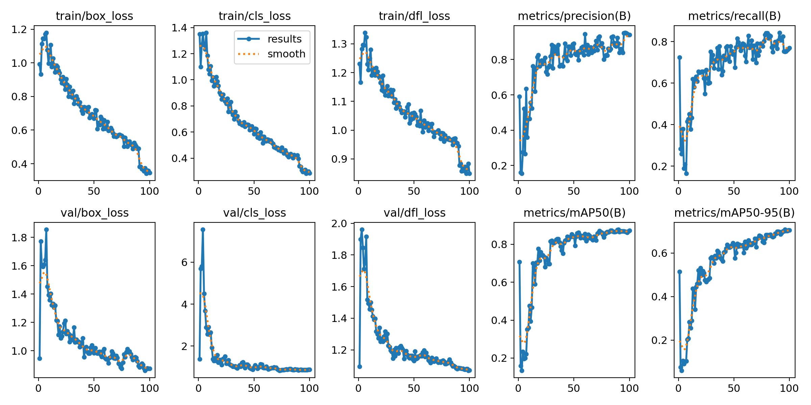
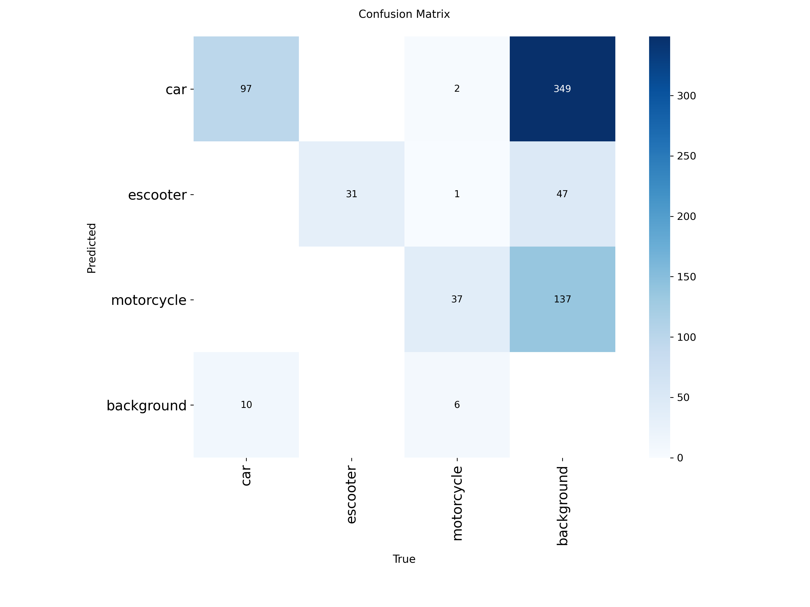

# YOLOv8 Fine-tuning: 자동차 · 전동킥보드 · 오토바이 감지 및 추적

YOLOv8s 모델을 3개 부류(car, escooter, motorcycle) 데이터로 fine-tuning하고,
학습된 모델로 거리 영상에서 객체 감지 및 추적을 수행했습니다.

## 결과 영상

[results/tracking_result_conf055.mp4](results/tracking_result_conf055.mp4)

- 객체별 ID와 이동 궤적(trajectory)을 함께 표시
- 프레임별 궤적 좌표는 `results/trajectories_conf055.csv`에 저장
- 신뢰도 임계값(conf) 0.55 적용

## 데이터

| 항목 | 내용 |
|---|---|
| 수집 | 웹 이미지 검색 크롤링 → 직접 선별 |
| 라벨링 | Roboflow (자동 라벨링 후 수동 검수) |
| 이미지 수 | 331장 (train 233 / valid 65 / test 33) |
| 박스 수 | car 529 / escooter 162 / motorcycle 156 |

※ 크롤링 이미지의 저작권 문제로 데이터셋은 공개하지 않습니다.

## 학습

- 모델: YOLOv8s (COCO pretrained)
- epochs 100, imgsz 640, batch 16, Colab T4 GPU (약 9분)



## 성능 (테스트셋)

| Class | Precision | Recall | mAP50 | mAP50-95 |
|---|---|---|---|---|
| all | 0.949 | 0.861 | 0.936 | 0.818 |
| car | 0.942 | 0.643 | 0.843 | 0.669 |
| escooter | 0.986 | 0.941 | 0.970 | 0.894 |
| motorcycle | 0.919 | 1.000 | 0.995 | 0.892 |



## 파일 구성

| 파일 | 설명 |
|---|---|
| `02_train_and_track.ipynb` | 학습, 평가, 객체 추적 |
| `weights/best.pt` | 학습된 모델 |
| `results/` | 추적 영상, 궤적 CSV, 학습 그래프 |

## 사용법

```python
from ultralytics import YOLO

model = YOLO("weights/best.pt")
model.track("video.mp4", tracker="bytetrack.yaml", conf=0.55, save=True)
```

## 참고
- [Ultralytics YOLOv8](https://github.com/ultralytics/ultralytics)
